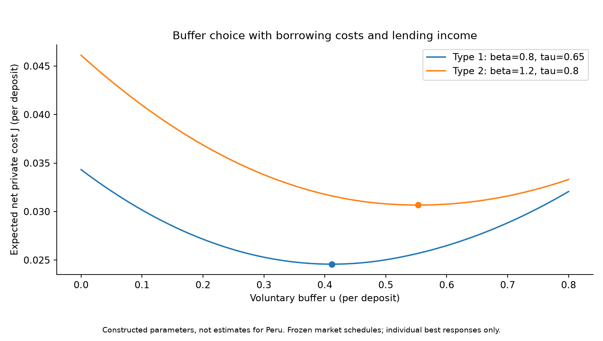
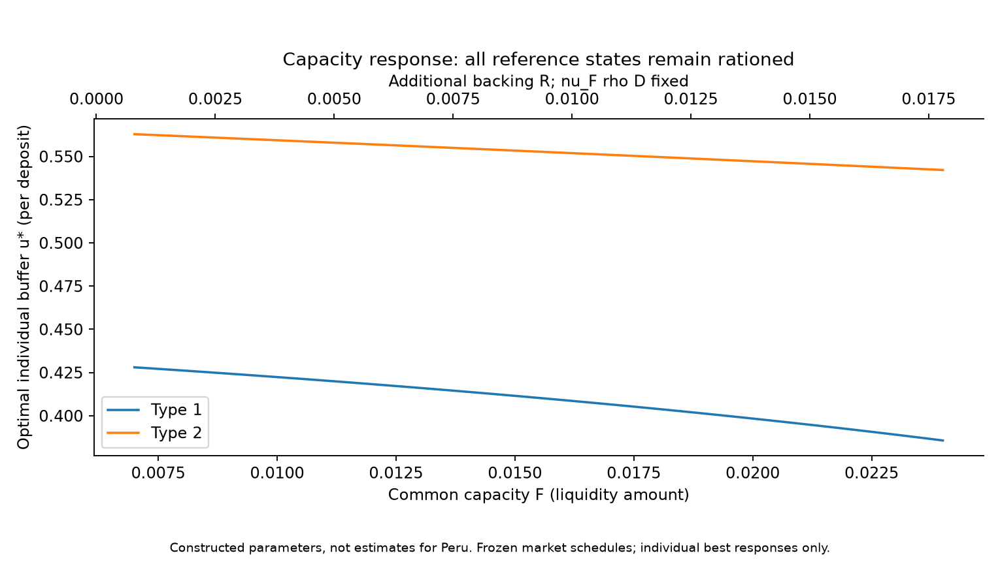
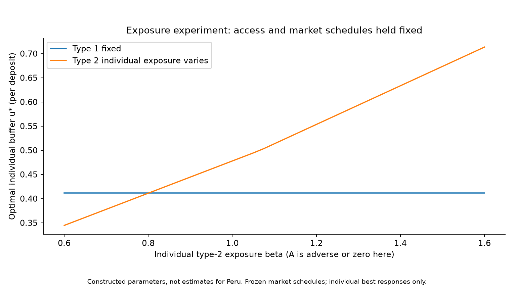

# Voluntary Liquidity Buffers under Finite Common Coverage

**Carlos Gómez Puicán · Universidad del Pacífico**

AI & Economic Modeling · **Track B: thesis model**

[Paper](paper/paper.pdf) · [Presentation](slides/final.pdf) · [Model](code/post_marco_model.py) · [Evidence](hand/README.md) · [Replication guide](docs/REPLICATION.md)

Banks pay to hold liquidity before shocks arrive. Common protection can reduce subsequent shortfalls, while a larger buffer can also earn interbank lending income. These competing incentives make private liquidity choice depend on exposure, access and available coverage.

**Research question:** How does finite common coverage affect an individual bank’s optimal voluntary buffer under prescribed interbank allocation?

## Contribution

The current **post-Marco benchmark** has one currency (USD), two bank types, signed liquidity flows and required reserves unavailable for personal use. A bank chooses its buffer before shocks, taking population allocation schedules as given.

- **Proposition 1 — Private choice.** Establishes existence, the lender-inclusive first-order condition, and convexity, corner and uniqueness conditions. Lending income means convexity is not automatic.
- **Proposition 2 — Conditional capacity response.** More capacity weakly reduces buffers along a regular interior branch of local minima: positive capacity and curvature, locally continuous densities, no coverage kink, and fixed prices, laws, domain and population schedules. Strict decrease requires a positive-probability state with rationing, incomplete interbank coverage and a positive deficit probability. A unique global optimum at the base continues locally.

## Selected simulations

**Constructed examples, not estimates for Peru.** Select a figure title for the full-size plot; [parameters and exported results](code/output/post_marco/) accompany every experiment.

| [Buffer choice](code/figures/post_marco/cost_and_optima.png) | [Common capacity](code/figures/post_marco/capacity_response.png) | [Individual exposure](code/figures/post_marco/exposure_response.png) |
|:---|:---|:---|
|  |  |  |
| Both types have interior optima; their exposure and access differ. | Buffers fall while reference states remain rationed and schedules stay fixed. | Type 2’s buffer rises on this grid; type 1 stays fixed. This is not a universal exposure theorem. |

## Evidence and reproduction

**99 checks in total; 33 concern the current model.** The other 28 October and 38 November-4 checks preserve historical verification. Inspect the [verification entry point](code/verify.py), [current check report](code/output/post_marco/verification.json) and [computational audit](code/POST_MARCO_AUDIT.md).

```sh
python -m pip install -r code/requirements.txt
python code/verify.py
```

The verifier regenerates outputs and figures. The [replication guide](docs/REPLICATION.md) covers an isolated environment, PDF builds, file navigation and model versions.

**Handwritten evidence complete:** [02](hand/02-post-marco-shortfall-surplus.pdf) / [03](hand/03-post-marco-buffer-optimality.pdf) / [04](hand/04-post-marco-capacity-response.pdf) / [05](hand/05-post-marco-conservation-incidence.pdf) / [06](hand/06-post-marco-differentiation-existence.pdf) / [07](hand/07-post-marco-convexity-optimality.pdf) / [08](hand/08-post-marco-uniform-enumeration.pdf) / [09](hand/09-post-marco-optimizer-continuation-incidence.pdf). These are 23 genuine student-written pages. Manuscript 07 p. 3 qualifies manuscript 03 p. 2; the original scan is unchanged. See the [evidence inventory](hand/README.md) and [authentic AI record](prompts.md).

**Lean:** [Proposition 1 proved; Proposition 2 partial](lean/docs/PAPER_TO_LEAN.md). Its economic IFT, base-point response and strict local-minimum persistence are proved; global continuation, the neighborhood-wide formula and exported local uniqueness remain open. The integrated [Spec/proof interface](lean/ProofInterface.lean) formalizes the [immutable paper source](https://github.com/carlosgomezp28/ai-project/blob/5b2959633962f46fc59d963b92f756e06da2ff00/paper/paper.pdf). Build, registration, recursive axiom audit and course `--fast` pass; [reproduction and logs](lean/docs/REPRODUCE.md) state their scope. The [31 historical closures](archive/lean-november4/README.md) receive no current-model proof credit.

## Scope and provenance

The thesis architecture is joint work by **Carlos Gómez Puicán and Fabián Méndez Suárez**, supervised by **Marco Ortiz**. Carlos’s individual course contribution is the buffer-choice closure, proofs, verification and constructed simulations.

Results concern individual conditional best responses. Aggregate equilibrium, endogenous interbank participation, welfare effects and empirical calibration are outside the current contribution. Prescribed allocations and course specializations are maintained assumptions. [Historical milestones](docs/REPLICATION.md) remain preserved; [course requirements](https://github.com/alexanderquispe/AI-Econ-Modeling/issues/7) govern the final submission.
